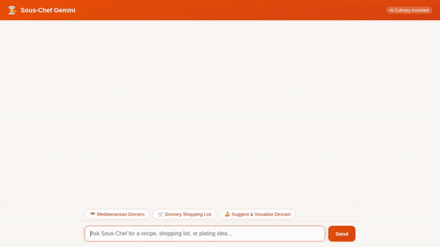

# 👨‍🍳 Sous-Chef Gemini

**Sous-Chef Gemini** is an agentic AI culinary assistant and meal planning companion built with the Google Agent Development Kit (ADK) and Gemini on Vertex AI. It helps users discover recipes, store customized dishes, compile grocery lists, and visualize plating presentations while strictly respecting dietary needs and remembering allergies across conversations.



---

## What the Agent Actually Does

The agent is powered by `gemini-3.8-flash` with the following implemented and wired components:

### 1. Cross-Session Allergy & Dietary Memory
- **Vertex AI Memory Bank (`PreloadMemoryTool` + `add_session_to_memory`)**: Automatically persists and recalls user allergies, dietary intolerances, and adverse food reactions across separate sessions.
- **Strict Allergy Safety**: Enforced at the prompt level to reject any ingredients or recipes conflicting with remembered user allergens.

### 2. Recipe Management & Custom Storage
- **Cloud Firestore Database**:
  - `search_recipes`: Queries saved dishes by cuisine and dietary preferences.
  - `get_recipe_details`: Retrieves ingredient lists and step-by-step cooking instructions by recipe ID.
  - `save_recipe`: Stores user-customized dishes directly into the project's Firestore database.
  - `generate_grocery_list`: Consolidates ingredients across selected recipes into a shopping checklist.

### 3. Public Recipe Discovery
- **TheMealDB API (`fetch_web_recipes`)**: Fetches recipes from the public web when users request dish inspiration outside their personal collection.

### 4. Dish Visualization & Plating
- **Gemini Image Generation (`generate_dish_image`)**:
  - Generates realistic dish plating and presentation imagery using `gemini-3.1-flash-lite-image`.
  - Saves the image as an ADK session artifact.
  - Automatically uploads the image bytes directly to a public **Google Cloud Storage** bucket (`sous-chef-gemini-assets-*`) and returns a shareable HTTPS URL.

### 5. Rich UI & Dialogue Experience
- **A2UI (Agent-to-User Interface v0.8)**: Generates structured Basic Catalog cards (`Card`, `Column`, `Row`, `Text`, `Image`) rendered directly in the chat stream.
- **FastAPI A2A Proxy**: A minimal proxy that talks to the agent over the A2A (Agent-to-Agent) protocol with Application Default Credentials (ADC).
- **Custom Dialogue Interface**: Styled with culinary terracotta accents, participant avatars, quick-prompt suggestion chips, and an animated cooking status loader (`🍲 Simmering your request...`).

> **Note on Planned Features**: Automatic nutritional macro calculations and BigQuery meal history analytics noted in early planning are **planned, not yet implemented**.

---

## Google Cloud Services Used

| Service | Role in this Project |
| :--- | :--- |
| **Vertex AI Agent Runtime (Agent Engine)** | Runs the deployed agent container serving the A2A protocol. |
| **Vertex AI Memory Bank** | Manages cross-conversation episodic memory for user food allergies. |
| **Gemini on Vertex AI (`gemini-3.8-flash`)** | Core reasoning, conversational flow, and function tool calling. |
| **Gemini Image Generation (`gemini-3.1-flash-lite-image`)** | Generates photorealistic dish plating visuals. |
| **Cloud Firestore** | Stores saved recipe collections, ingredient lists, and cooking steps. |
| **Cloud Storage** | Public asset hosting for generated dish presentation images. |

---

## Project Structure

```text
.
├── app/
│   ├── __init__.py
│   ├── agent.py            # Agent definition, system instructions, Memory Bank & A2UI callbacks
│   ├── a2ui_utils.py       # A2UI response formatter callback
│   ├── tools.py            # Firestore tools, TheMealDB integration, and Cloud Storage image gen
│   ├── fast_api_app.py     # FastAPI app entrypoint for Agent Runtime
│   └── app_utils/          # Service loaders for Firestore, Memory, and Storage
├── frontend/
│   ├── main.py             # FastAPI proxy connecting browser to deployed agent over A2A
│   ├── requirements.txt    # Minimal proxy dependencies (FastAPI, a2a-sdk, httpx)
│   └── static/
│       └── index.html      # Themed chat dialogue UI with A2UI renderer and prompt chips
├── demo.gif                # Looping demonstration of recipe discovery & dish visualization
├── pyproject.toml          # ADK project dependencies and package specifications
└── agents-cli-manifest.yaml# Agent metadata and runtime deployment configuration
```

---

## Local Setup & Run Instructions

### Prerequisites
- Python 3.11 or 3.12
- Google Cloud SDK (`gcloud`) authenticated with Application Default Credentials:
  ```bash
  gcloud auth application-default login
  ```

### 1. Running the Agent Backend Locally (ADK Playground)
To run the ADK agent with Vertex AI Memory Bank enabled:

```bash
# In the repository root
uv sync
uv run adk web . --port 8080 --reload_agents --memory_service_uri=agentengine://<YOUR_AGENT_ENGINE_ID>
```

### 2. Running the Frontend Chat UI
To run the themed chat frontend against a deployed Agent Runtime instance:

```bash
cd frontend

# Create a virtual environment and install dependencies
uv venv .venv --python 3.12
source .venv/bin/activate
uv pip install -r requirements.txt

# Configure environment variables
export AGENT_ENGINE_RESOURCE_NAME="projects/<PROJECT_ID>/locations/<REGION>/reasoningEngines/<ENGINE_ID>"
export AGENT_DIRECTORY="app"

# Start the frontend server
python main.py
```
